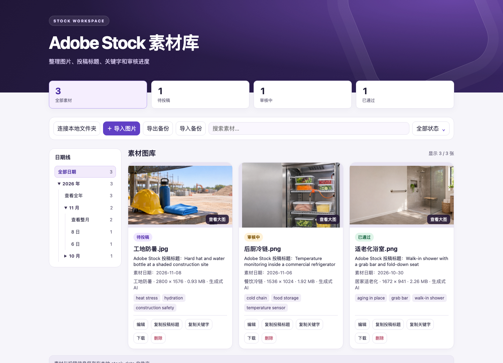

# Adobe Stock 素材管理器

一个在浏览器里运行的本地图库，用来整理 Adobe Stock 投稿图片、英文标题、关键字和审核进度。项目由单个 HTML 文件组成，打开即可使用，无需安装依赖、构建项目或启动后端服务。

## 界面预览



截图使用示例图片和演示投稿状态。

## 功能

- 批量导入 JPEG、PNG、WebP、AVIF 和 GIF，查看缩略图、原图、分辨率和文件大小。
- 分开管理图片文件标题和 Adobe Stock 投稿标题，一键复制投稿标题和关键字。
- 记录素材日期、分类、备注和生成式 AI 标记，跟踪待整理、待投稿、审核中、已通过和需修改等状态。
- 通过左侧日期线查看全年、整月或某一天的素材，也可以叠加搜索和状态筛选。
- 将原始图片和投稿信息保存在本地文件夹，支持导出和恢复 JSON 备份。

## 快速开始

1. 下载或克隆仓库，用支持本地文件夹写入的桌面版 Chrome 或 Edge 打开 [`dist/index.html`](dist/index.html)。
2. 点击 **连接本地文件夹**，选择包含 `index.html` 的 **`dist` 文件夹**，并授权读取和写入。重新打开页面后，再连接同一文件夹即可加载原有素材。
3. 点击 **导入图片**，为这批图片选择素材日期并确认导入。
4. 在图片卡片上点击 **编辑**，填写标题、关键字和投稿状态。点击缩略图可查看大图。

如果浏览器内嵌预览无法打开文件夹选择器，请直接用桌面浏览器打开 HTML。文件夹读写依赖 [File System Access API](https://developer.chrome.com/docs/capabilities/web-apis/file-system-access)。

## 本地数据与备份

连接后，应用会在 `index.html` 同级创建 `stock-data`：

```text
dist/
├── index.html
└── stock-data/
    ├── images/         # 导入的原始图片
    └── metadata.json  # 图片路径、标题、关键字、日期和投稿状态等
```

- **文件夹备份** — 复制整个 `stock-data` 文件夹。恢复到另一份项目时，把它放在 `index.html` 同级，再连接该目录。
- **JSON 备份** — 页面里的 **导出备份** 会把图片和元数据打包为一个 JSON。使用 **导入备份** 可以恢复。日常保存的 `metadata.json` 仅记录元数据和图片路径。
- **迁移旧版数据** — 如果旧版图库曾把图片保存在浏览器里，在原浏览器打开页面并连接文件夹，再点 **迁移浏览器素材**。迁移会把旧素材复制到本地文件夹。

## 项目文件

- [`dist/index.html`](dist/index.html) — 管理器页面，包含界面、日期筛选和本地读写逻辑。
- [`images/`](images/) — 随项目整理的示例素材。
- [`skills/adobe-stock-images/`](skills/adobe-stock-images/) — 可选的 Codex 投稿准备技能和 macOS JPEG 规格检查脚本。管理页本身不依赖该技能。

发布到 GitHub 前，请把 `dist/stock-data/`、导出的备份 JSON 和系统生成的 `.DS_Store` 留在本地。示例图片只发布你有权公开分享的版本。

这是独立的素材整理工具。实际投稿在 Adobe Stock Contributor 后台完成，素材规格与审核以 [Adobe Stock 官方投稿要求](https://helpx.adobe.com/stock/contributor/content-policies-guidelines/content-policies/content-upload-guidelines.html) 为准。
